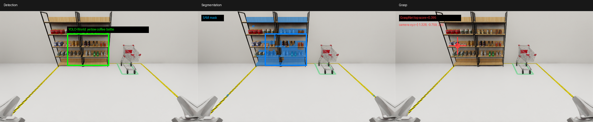
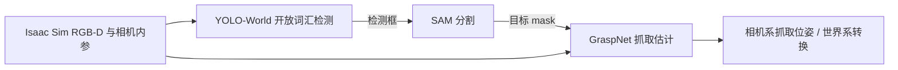

# YOLO-World + SAM + GraspNet in Isaac Sim

开放词汇目标检测、提示式分割和 RGB-D 抓取位姿估计的仿真项目代码归档。代码来自 5090 上的 `model_config` 和 Isaac Sim 场景脚本；图片为一次仿真运行的可视化记录。

> 图中是调试可视化：检测框和分割区域覆盖了货架的一大块区域，不能据此认定单个瓶子已被准确分割或成功抓取。抓取标记是候选结果，不是实机执行证明。

## 流程

`graspnet_pipeline/model_compose.yaml` 描述 YOLO-World → SAM → GraspNet 的串行 DAG。模型适配代码在 `yolo_world/`、`sam_segment/`、`graspnet/`。`examples/isaac_sim/` 包含 RGB-D 导出、SAM 框提示、结果绘图和基线推理脚本。原始环境笔记保存在 `docs/original_model_config_README.md`，其中的机器路径是历史记录。

## 运行前提

这是一份研究环境代码归档，**尚未整理成一键运行的独立发行版**。模型服务依赖原项目的 `invoke`/`base.base_model_service` 编排接口、Redis 连接工具，以及 PyTorch、Ultralytics、Segment Anything、GraspNet baseline、graspnetAPI、Open3D、OpenCV 和 Isaac Sim。请按各上游项目的安装说明配置与版本匹配的环境。

模型权重、第三方源码、仿真资产、点云和运行结果未纳入仓库。运行前需要自行获取对应权重并放到 YAML 指定的位置；GraspNet baseline 路径可通过 `GRASPNET_BASELINE_DIR` 设置。Redis 连接仍需由原编排环境的 `utils.utils.connect_remote_redis` 提供。`examples/isaac_sim/` 中的默认路径来自原 5090 环境，换机器运行时请调整路径、容器名和脚本参数。

## 验证范围

本仓库的 Python 文件通过语法编译检查，YAML 可解析。没有在干净环境中完成模型推理或机器人抓取验证。图片仅用于展示仿真场景与调试输出。
