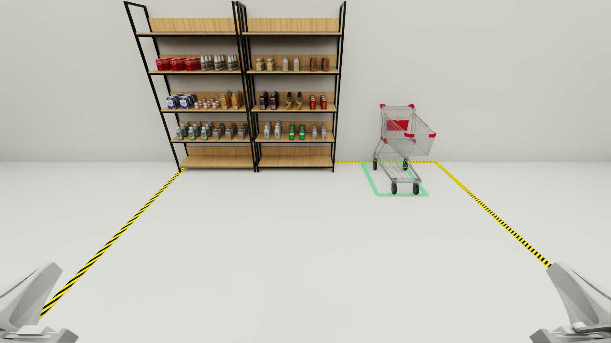
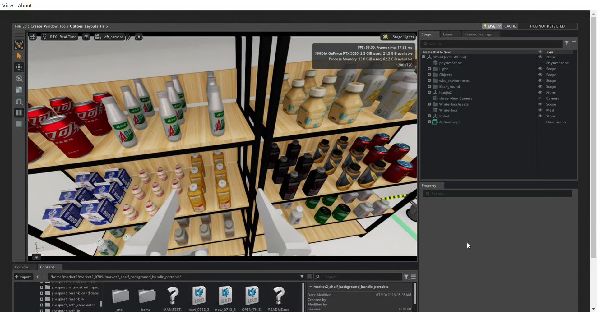
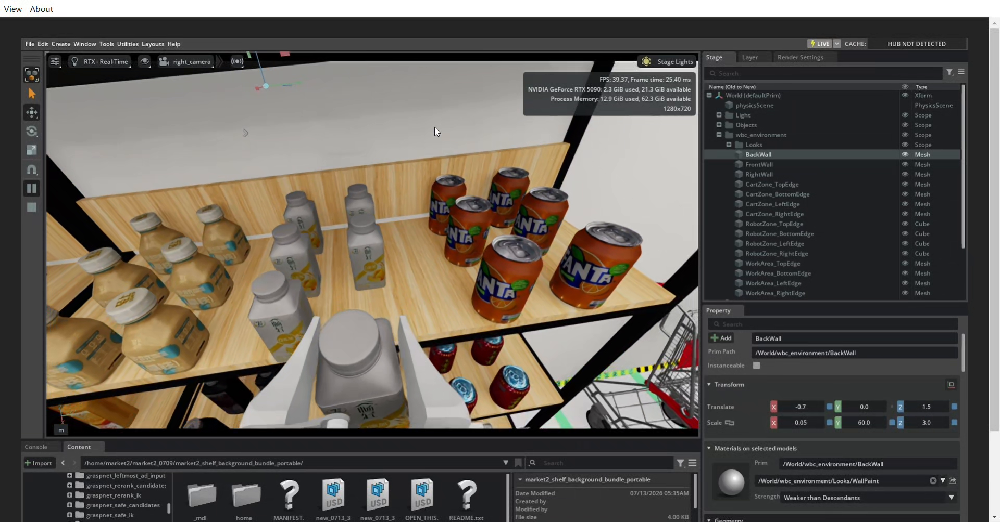
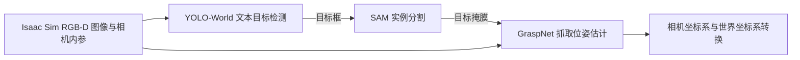

# YOLO-World + SAM + GraspNet in Isaac Sim

面向仿真机器人抓取的视觉感知流程：用 YOLO-World 根据文本定位目标，以 SAM 提取目标区域，再结合 RGB-D 数据估计 GraspNet 抓取位姿。



## 仿真画面

[场景漫游视频](videos/isaac_sim_scene_walkthrough.mp4)展示了货架、商品、购物车和机器人视角。

| 机器人与货架 | 右腕相机与夹爪 |
| --- | --- |
| [](videos/isaac_sim_robot_demo_01.mp4) | [](videos/isaac_sim_robot_demo_02.mp4) |
| [观看视频 1](videos/isaac_sim_robot_demo_01.mp4) | [观看视频 2](videos/isaac_sim_robot_demo_02.mp4) |

## 感知流程



`graspnet_pipeline/model_compose.yaml` 定义模型调用顺序。`yolo_world/`、`sam_segment/`、`graspnet/` 分别包含模型适配代码；`examples/isaac_sim/` 提供 RGB-D 导出、框提示分割、抓取推理和结果可视化脚本。

## 使用

项目使用 Python、Isaac Sim、YOLO-World、Segment Anything、GraspNet 与 Open3D。按各上游项目说明安装模型及其依赖，并在 `graspnet_pipeline/model_compose.yaml` 中配置权重路径和服务参数。GraspNet baseline 路径可通过 `GRASPNET_BASELINE_DIR` 设置。

```bash
# 在已配置 Isaac Sim 与模型依赖的环境中
python examples/isaac_sim/export_isaac_rgbd_for_graspnet.py --help
python examples/isaac_sim/run_sam_bbox_prompt.py --help
```

仿真场景漫游的录制脚本为 `examples/isaac_sim/record_scene_video.py`。录像展示场景和机器人视角；感知流程的模型输出由相应推理与可视化脚本生成。
